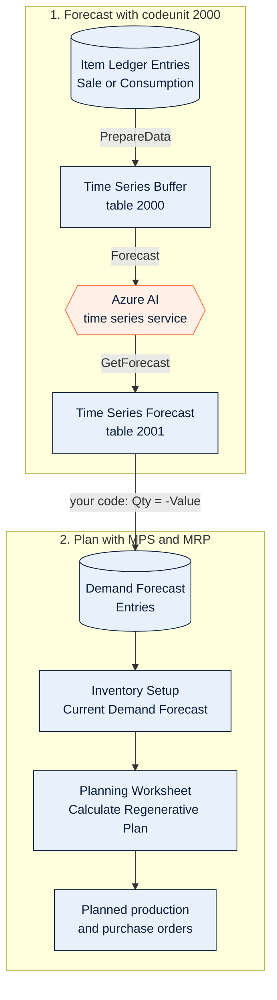
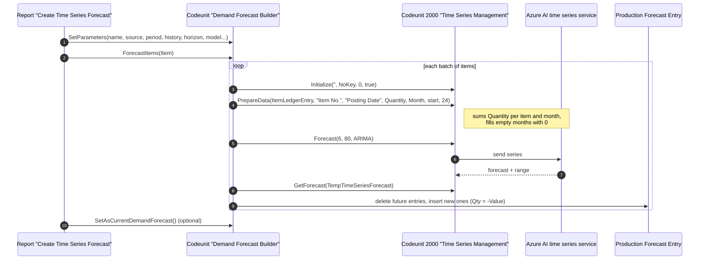
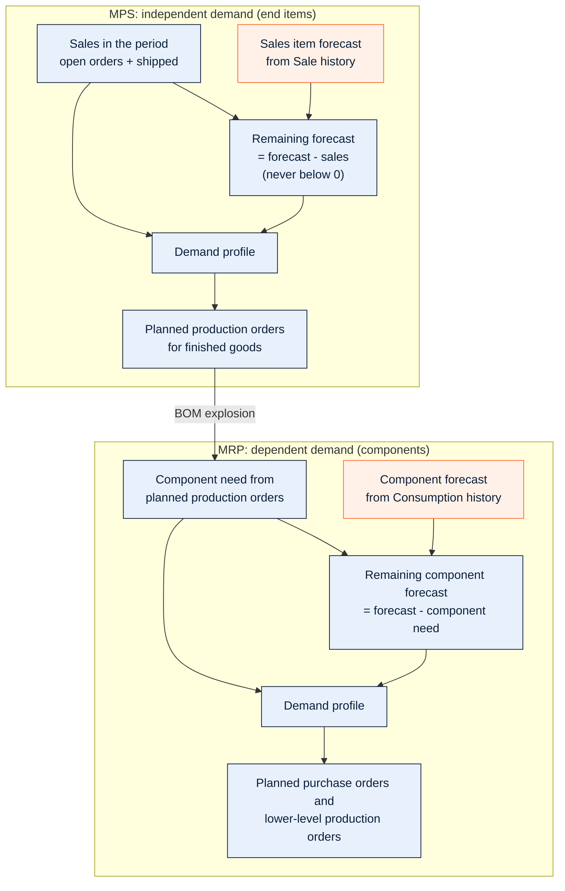

# BC Time Series Demand Forecast

[](https://opensource.org/licenses/MIT)
[](https://learn.microsoft.com/en-us/dynamics365/business-central/)

A free, MIT-licensed Business Central extension that turns posted sales (or consumption) into a **demand forecast that MPS and MRP really use**. It calls the forecasting engine every tenant already has: codeunit 2000 **"Time Series Management"** (Azure AI time series: ARIMA, ETS, STL, TBATS).

**Companion blog post:** [Codeunit 2000 Forecasting in Business Central: From Sales History to MPS and MRP](https://insidebusinesscentral.com/codeunit-2000-time-series-forecast-mps-mrp/)

> If this saves you time, please **star the repo**. It helps other Business Central folks find it.

Part of the replenishment set:

- [bc-safety-stock](https://github.com/GmsoftLtd/bc-safety-stock): how much buffer to hold (50100-50199)
- [bc-eoq-calculator](https://github.com/GmsoftLtd/bc-eoq-calculator): how much to order (50200-50299)
- [bc-reorder-point](https://github.com/GmsoftLtd/bc-reorder-point): when to order (50300-50399)
- [bc-replenishment-policy](https://github.com/GmsoftLtd/bc-replenishment-policy): which policy (50400-50499)
- **bc-demand-forecast-mps-mrp**: what demand to plan for (50500-50599)

---

## What it does



1. Reads Item Ledger Entries of type **Sale** (or **Consumption**) for the filtered items.
2. Sends one series per item to codeunit 2000 with `PrepareData`, `Forecast` and `GetForecast`.
3. Flips the sign (sales are negative in the ledger), optionally drops lines whose range (Delta %) is too wide.
4. Replaces the future **Demand Forecast Entries** of those items in the forecast you choose.
5. Optionally makes it the **Current Demand Forecast** in Inventory Setup.

| Demand Source | Forecast type written | Used by |
|---|---|---|
| Sales | Sales Item | MPS (independent demand, consumed by sales) |
| Consumption | Component | MRP (dependent demand, consumed by component need) |

## How it calls codeunit 2000



```al
TimeSeriesManagement.Initialize('', NoKey, 0, true);   // BC online, Microsoft-hosted service
TimeSeriesManagement.PrepareData(
    ItemLedgerEntry,
    ItemLedgerEntry.FieldNo("Item No."),      // one series per item
    ItemLedgerEntry.FieldNo("Posting Date"),
    ItemLedgerEntry.FieldNo(Quantity),
    DateRec."Period Type"::Month,
    ForecastStart,                            // history runs back from this date
    24);                                      // periods of history
TimeSeriesManagement.Forecast(6, 80, 0);       // 6 periods, 80% confidence, 0 = ARIMA
TimeSeriesManagement.GetForecast(TempTimeSeriesForecast);
```

## How MPS and MRP use it



Planning reduces the forecast by the sales in the same forecast period (open orders and shipped), and only the remainder enters the demand profile. A forecast period runs from the forecast date to the next forecast date.

## Objects

| Type | ID | Name |
|---|---|---|
| Codeunit | 50500 | Demand Forecast Builder |
| Codeunit | 50501 | Location Series Example (SetPreparedData, item x location) |
| Report | 50500 | Create Time Series Forecast (search: *Create Time Series Demand Forecast*) |
| Enum | 50500 | Time Series Model (ordinals = codeunit 2000 model option) |
| Enum | 50501 | Forecast Demand Source |
| Enum | 50502 | Forecast Period |
| Permission set | 50500 | Time Series Forecast |

## Install

**Sandbox first.**

1. Clone, download symbols for BC 29 and publish from VS Code, or upload a release `.app` in Extension Management.
2. Assign the permission set **Time Series Demand Forecast**.
3. Search **Create Time Series Demand Forecast**, filter a few items, keep the defaults (TS-FCST, Sales, Month, 24 / 6 periods, ARIMA, 80%).
4. Check **Demand Forecasts** > TS-FCST.
5. **Planning Worksheet** > **Calculate Regenerative Plan**, tick MPS and MRP, Use Forecast = TS-FCST.

It writes only Demand Forecast Entries (and Inventory Setup if you choose). Delete the forecast name and it is all gone.

## Notes

- BC online uses the Microsoft-hosted service and counts against the tenant's Azure AI usage. On-premises: pass your own Azure ML URI and key to `Initialize` (keep the key in isolated storage).
- The model parameter is an Option: 0 ARIMA, 1 ETS, 2 STL, 3 ETS+ARIMA, 4 ETS+STL, 5 ALL, 6 TBATS. STL needs more than two years of data.
- Items are sent 50 per call to avoid service time-outs (`SetBatchSize`).
- Forecast at item level (blank location and variant). See codeunit 50501 for location level.
- Do not forecast make-to-order (Order policy) end items, and do not combine a forecast with a reorder point on the same item: you count demand twice.

## Build

Compiled with the AL compiler 18.1 against Base Application 29.0, with CodeCop, UICop and PerTenantExtensionCop: no warnings.

## Contributing

PRs welcome for location and variant level, a Query-based history reader, and a forecast accuracy check.

## License

MIT. See [LICENSE](LICENSE).
